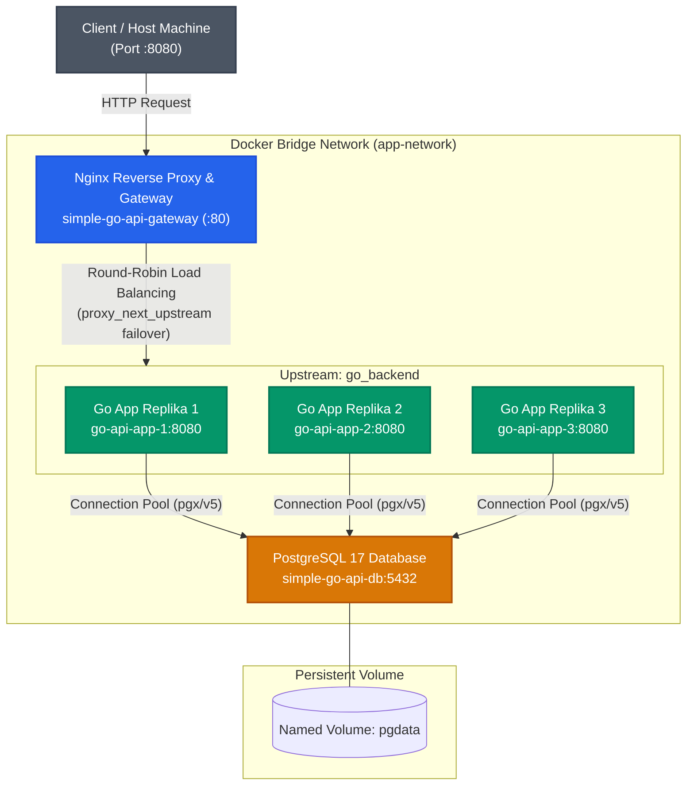

# Simple Product & Auth API — Golang (Dockerized)

Proyek RESTful API berbasis Golang dan PostgreSQL yang diorkestrasi menggunakan Docker Compose dengan arsitektur Clean Code, multi-stage Docker build, volume persistensi, serta Nginx Reverse Proxy & Load Balancer.

> Proyek ini disusun untuk memenuhi **Tugas 1 (Dockerisasi Backend)** & **Tugas 2 (Nginx Reverse Proxy, Load Balancer & Gateway)** — Study Club Backend Intermediate, KSM Veterantech UPNVJ 2026.

---

## 🛠 Tech Stack & Tools

- **Backend**: Go 1.22+ (`net/http`, Standard Go Layout)
- **Database**: PostgreSQL 17 (via Docker Container)
- **Database Driver**: [pgx/v5](https://github.com/jackc/pgx)
- **Query Generator**: [sqlc](https://sqlc.dev)
- **Authentication**: JWT (`golang-jwt/jwt/v5`) & `golang.org/x/crypto/bcrypt`
- **Containerization**: Docker & Docker Compose (Multi-stage build)
- **Database GUI**: JetBrains DataGrip / DBeaver / pgAdmin

## 🏛 Application Architecture & Project Structure

Mengikuti prinsip *Clean Architecture* dan *Standard Go Project Layout*:

```text
Handler (HTTP) → Service (Business Logic) → Repository (Database Layer) → PostgreSQL
```

```text
go-api/
├── cmd/
│   └── api/
│       └── main.go                 # Entry point aplikasi (injeksi dependensi & router)
├── db/
│   ├── queries/
│   │   ├── product.sql             # SQL queries untuk produk (input sqlc)
│   │   └── users.sql               # SQL queries untuk users & auth (input sqlc)
│   └── schema/
│       ├── products.sql            # Skema DDL tabel products
│       └── users_and_sessions.sql  # Skema DDL tabel users & sessions
├── internal/
│   ├── db/                         # Kode type-safe yang digenerate oleh sqlc
│   ├── handlers/                   # Layer HTTP (Product & Auth Handler)
│   ├── middleware/                 # Middleware (Auth JWT, Logger, Recoverer)
│   ├── models/                     # Model data / entity
│   ├── repository/                 # Layer akses database
│   ├── routes/                     # Definisi rute URL & middleware binding
│   └── services/                   # Layer logika bisnis & validasi
├── migrations/                     # Skrip SQL untuk inisialisasi database di Docker
├── Dockerfile                      # Multi-stage Docker build
└── docker-compose.yml              # Orkestrasi multi-container backend & database
```

---

## 🏗 Arsitektur Container (Docker Compose)

Aplikasi dan database berjalan di dalam container terisolasi yang dihubungkan melalui satu bridge network (`app-network`):

```text
[Host Machine (Komputer Lokal)]
  │
  ├── Port 8080 ──────────────> [Container: simple-go-api-app (Go Backend)]
  │                                    │
  │                              (Bridge Network: app-network)
  │                                    │
  └── Port 5434 (DataGrip) ───> [Container: simple-go-api-db (PostgreSQL 17)]
                                       │
                                 (Named Volume: pgdata)
```

---

## 📋 Prasyarat (Prerequisites)

Sebelum menjalankan aplikasi, pastikan komputer Anda telah terinstal:
- [Docker Engine & Docker Compose](https://docs.docker.com/get-docker/) (Docker Desktop)
- [Git](https://git-scm.com/)
- *(Opsional)* [Go 1.22+](https://go.dev/dl/) jika ingin menjalankan secara lokal tanpa Docker
- *(Opsional)* [DataGrip](https://www.jetbrains.com/datagrip/) atau Database Client lainnya

---

## 🚀 Panduan Setup & Menjalankan Aplikasi

### 1. Clone the repository

```bash
git clone https://github.com/Torikh42/simple-go-api.git
cd simple-go-api
```

### 2. Setup Environment Variables
Salin template konfigurasi `.env.example` menjadi `.env`:
```bash
cp .env.example .env
```

### 3. Build & Jalankan Seluruh Layanan (Docker Compose)
Jalankan perintah berikut untuk mem-build image backend dan menyalakan seluruh service:
```bash
docker compose up --build -d
```
> **Catatan:**
> - Service `postgres` akan otomatis menginisialisasi skrip SQL pada folder `./migrations` saat pertama kali container dibuat.
> - Service `app` memiliki *healthcheck dependency*, sehingga backend hanya akan menyala setelah PostgreSQL siap menerima koneksi.

Periksa status container yang sedang berjalan:
```bash
docker compose ps
```

Untuk melihat log aplikasi secara langsung:
```bash
docker compose logs -f app
```

---

## 🔌 Panduan Koneksi Database ke DataGrip (Mode Debugging)

Pada arsitektur Tugas 2 (*Single Entry Point*), port PostgreSQL sengaja disembunyikan dari host machine demi menerapkan prinsip keamanan *Least Privilege* dan *Defense in Depth*.

Jika Anda memerlukan akses langsung ke PostgreSQL untuk inspeksi visual via JetBrains DataGrip, DBeaver, atau pgAdmin, gunakan Docker Compose override:

```bash
docker compose -f docker-compose.yml -f docker-compose.db-debug.yml up -d
```

Setelah file override aktif, port database `5434` akan dipublikasikan ke host machine:
1. Buka **DataGrip** $\rightarrow$ klik **+ (New)** $\rightarrow$ **Data Source** $\rightarrow$ **PostgreSQL**.
2. Masukkan parameter koneksi:
   - **Host**: `localhost` (atau `127.0.0.1`)
   - **Port**: `5434` *(port yang dibuka melalui compose override)*
   - **User**: `postgres`
   - **Password**: `postgres`
   - **Database**: `go_api_db`
3. Klik **Test Connection**. Jika diminta unduh driver, klik *Download Driver Files*.
4. Setelah status berhasil (*Succeeded*), klik **Apply** $\rightarrow$ **OK**.

> **Note:** Untuk mengembalikan sistem ke mode produksi "Satu Pintu", cukup jalankan kembali `docker compose up -d` tanpa file override. Port `5434` akan otomatis tertutup kembali.

---

## 📡 Pengujian API Endpoints

Setelah container menyala, API dapat diakses di `http://localhost:8080`.

### Daftar Endpoint:

| Method | Endpoint | Keterangan | Akses |
| :--- | :--- | :--- | :--- |
| `GET` | `/health` | Healthcheck API | Public |
| `POST` | `/register` | Registrasi user baru | Public |
| `POST` | `/login` | Login user & generate JWT | Public |
| `GET` | `/products` | Mengambil seluruh daftar produk | 🔒 Butuh JWT |
| `POST` | `/products` | Menambah produk baru | 🔒 Butuh JWT |
| `GET` | `/products/{id}` | Mengambil detail produk | 🔒 Butuh JWT |
| `PUT` | `/products/{id}` | Mengubah data produk | 🔒 Butuh JWT |
| `DELETE` | `/products/{id}` | Menghapus produk | 🔒 Butuh JWT |

---

### Contoh Pengujian Request:

#### 1. Registrasi User
```bash
curl -X POST http://localhost:8080/register \
  -H "Content-Type: application/json" \
  -d '{
    "username": "torikh",
    "email": "torikh@example.com",
    "password": "password123"
  }'
```

#### 2. Login untuk Mendapatkan Token
```bash
curl -X POST http://localhost:8080/login \
  -H "Content-Type: application/json" \
  -d '{
    "email": "torikh@example.com",
    "password": "password123"
  }'
```
*Salin token dari field `token` pada response JSON.*

#### 3. Membuat Produk Baru (Write Data)
```bash
curl -X POST http://localhost:8080/products \
  -H "Content-Type: application/json" \
  -H "Authorization: Bearer <TOKEN_JWT_ANDA>" \
  -d '{
    "name": "Keyboard Mechanical",
    "price": 750000,
    "stock": 15
  }'
```

#### 4. Membaca Produk (Read Data)
```bash
curl -X GET http://localhost:8080/products \
  -H "Authorization: Bearer <TOKEN_JWT_ANDA>"
```

---

## 💾 Pembuktian Persistensi Data (Rubrik Tugas 1)

Untuk membuktikan data di database tetap tersimpan (*persistent*) meskipun container dimatikan atau dibuat ulang:

1. **Tambah data produk baru** melalui endpoint `POST /products` atau cek data di DataGrip.
2. **Hentikan dan hapus container** (tanpa menghapus named volume):
   ```bash
   docker compose down
   ```
3. **Jalankan kembali container**:
   ```bash
   docker compose up -d
   ```
4. **Cek kembali data** menggunakan endpoint `GET /products` atau *refresh* di DataGrip:
   ```bash
   curl -X GET http://localhost:8080/products -H "Authorization: Bearer <TOKEN_JWT_ANDA>"
   ```
5. **Hasil:** Data produk yang telah dibuat sebelumnya tetap ada dan tidak hilang, membuktikan volume `pgdata` berfungsi dengan baik.

---

## 🌐 Tugas 2: Nginx Reverse Proxy, Load Balancer & Gateway

Bagian ini mendokumentasikan implementasi lengkap **Tugas 2: Nginx Reverse Proxy & Load Balancer**, mencakup perancangan arsitektur satu pintu, pembagian beban ke 3 replika container Go API, rate limiting, security hardening, caching, high availability failover, serta analisis konseptual sistem gateway.

---

### 🏛 Arsitektur Gateway & Diagram Alur Trafik

Arsitektur sistem dibangun dengan pola **Single Entry Point (API Gateway Pattern)** di mana seluruh trafik dari luar hanya dapat masuk melalui Nginx Reverse Proxy. Seluruh container backend dan database terisolasi dalam private bridge network (`app-network`).



#### 🛡️ Prinsip "Satu Pintu" (Single Entry Point):
1. **Hanya Nginx yang Membuka Port ke Host**: Satu-satunya port yang di-binding ke host machine adalah port `8080` milik container `simple-go-api-gateway` (`0.0.0.0:8080 -> 80`).
2. **Backend & Database Terisolasi Total**: Service `app` (3 replika) dan `postgres` tidak mendefinisikan directive `ports`. Port `8080` (Go) dan `5432` (PostgreSQL) hanya aktif di level bridge network internal (`app-network`).
3. **Bypass Protection**: Client dari host tidak dapat memotong jalur Nginx untuk langsung mengakses backend atau database. Upaya koneksi ke port `5434` atau `8081` secara langsung akan ditolak (*Connection Refused*).

---

### 🚀 Panduan Menjalankan Layanan

#### 1. Mode Standar / Evaluasi Tugas 2 (Satu Pintu Aman)
Gunakan perintah ini untuk evaluasi arsitektur produksi:
```bash
docker compose up --build -d
```
Verifikasi bahwa seluruh 5 container aktif dan sehat:
```bash
docker compose ps
```
*Status yang diharapkan:*
- `simple-go-api-gateway`: Status `Up` dengan port mapping `0.0.0.0:8080->80/tcp`.
- `go-api-app-1`, `go-api-app-2`, `go-api-app-3`: Status `Up (healthy)`, port `8080/tcp` (tanpa mapping host).
- `simple-go-api-db`: Status `Up (healthy)`, port `5432/tcp` (tanpa mapping host).

#### 2. Mode Debugging / Akses DataGrip (Compose Override)
Demi mematuhi prinsip *Least Privilege* dan *Defense-in-Depth*, port database disembunyikan dari host machine pada mode standar. Jika developer perlu menginspeksi tabel database secara visual menggunakan JetBrains DataGrip, gunakan file override:
```bash
docker compose -f docker-compose.yml -f docker-compose.db-debug.yml up -d
```
Untuk kembali ke mode aman satu pintu:
```bash
docker compose up -d
```

---

### 📊 Ringkasan Evaluasi 5 Checklist Utama + Bonus

| No | Kriteria Checklist | Status | Ringkasan Verifikasi Teknis |
| :---: | :--- | :---: | :--- |
| **1** | **Satu Pintu (Single Entry Point)** | **PASS** | Hanya Nginx yang dapat diakses di `:8080`. Port DB `:5434` dan Backend `:8081` ditolak (*Connection Refused*). |
| **2** | **Reverse Proxy & Dual Routing** | **PASS** | Nginx meneruskan request ke backend; rute `/` dan prefix `/api/*` (rewrite internal) berjalan normal. |
| **3** | **Load Balancing (Round-Robin 3 Replika)** | **PASS** | Header `X-Upstream` berotasi secara seimbang ke 3 IP container Go backend (`172.19.0.3`, `172.19.0.4`, `172.19.0.5`). |
| **4** | **Rate Limiting (HTTP 429)** | **PASS** | `POST /login` dibatasi `2r/s` dengan `burst=3 nodelay`. Request berlebih langsung menerima respons `HTTP 429 Too Many Requests`. |
| **5** | **Security Headers & Gzip Compression** | **PASS** | Header `X-Content-Type-Options: nosniff`, `X-Frame-Options: DENY`, `Referrer-Policy: no-referrer`, server tokens disembunyikan, dan payload di-compress dengan Gzip. |
| **B1** | **Bonus: In-Memory Proxy Caching** | **PASS** | Caching in-memory `proxy_cache` pada `GET /products` (TTL 10s) menghasilkan `X-Cache-Status: MISS` lalu `HIT`, dipartisi per Bearer Token. |
| **B2** | **Bonus: High Availability & Failover** | **PASS** | Saat salah satu container replika dihentikan paksa, Nginx otomatis failover via `proxy_next_upstream` sehingga 100% request tetap berhasil (`200 OK`). |

---

### 🔬 Bukti Pengujian Terminal Nyata (Raw Verification Output)

Berikut adalah bukti konkret hasil eksekusi perintah terminal cURL pada lingkungan container yang sedang berjalan:

#### Checklist 1: Satu Pintu (Single Entry Point)

Akses Nginx Gateway di port 8080 berhasil:
```powershell
curl.exe -i http://localhost:8080/health
```
```http
HTTP/1.1 200 OK
Server: nginx
Date: Sat, 07 Nov 2026 09:13:34 GMT
Content-Type: text/plain; charset=utf-8
Content-Length: 2
Connection: keep-alive
Vary: Accept-Encoding
X-Content-Type-Options: nosniff
X-Frame-Options: DENY
Referrer-Policy: no-referrer
X-Upstream: 172.19.0.3:8080

OK
```

Upaya akses langsung ke port database (:5434) dan backend (:8081) langsung ditolak oleh OS host (Exit Code 7):
```powershell
curl.exe -v http://localhost:5434; Write-Host "ExitCode: $LASTEXITCODE"
curl.exe -v http://localhost:8081; Write-Host "ExitCode: $LASTEXITCODE"
```
```text
*   Trying 127.0.0.1:5434...
* connect to 127.0.0.1 port 5434 failed: Connection refused
* Failed to connect to localhost:5434 after 2249 ms: Could not connect to server
curl: (7) Failed to connect to localhost:5434 after 2249 ms: Could not connect to server
ExitCode: 7

*   Trying 127.0.0.1:8081...
* connect to 127.0.0.1 port 8081 failed: Connection refused
* Failed to connect to localhost:8081 after 2237 ms: Could not connect to server
curl: (7) Failed to connect to localhost:8081 after 2237 ms: Could not connect to server
ExitCode: 7
```

---

#### Checklist 2: Reverse Proxy & Dual Routing Support

Akses root `/` diteruskan ke backend Go:
```powershell
curl.exe -i http://localhost:8080/
```
```http
HTTP/1.1 200 OK
Server: nginx
Date: Sat, 07 Nov 2026 09:13:48 GMT
Content-Type: text/plain; charset=utf-8
Content-Length: 29
Connection: keep-alive
Vary: Accept-Encoding
X-Content-Type-Options: nosniff
X-Frame-Options: DENY
Referrer-Policy: no-referrer
X-Upstream: 172.19.0.4:8080

Selamat datang di Go Backend!
```

Akses dengan prefix `/api/health` (Dual Routing ala API Gateway enterprise & Slide 57):
```powershell
curl.exe -i http://localhost:8080/api/health
```
```http
HTTP/1.1 200 OK
Server: nginx
Date: Sat, 07 Nov 2026 09:13:48 GMT
Content-Type: text/plain; charset=utf-8
Content-Length: 2
Connection: keep-alive
Vary: Accept-Encoding
X-Content-Type-Options: nosniff
X-Frame-Options: DENY
Referrer-Policy: no-referrer
X-Upstream: 172.19.0.3:8080

OK
```
*Aturan rewrite Nginx `location ~ ^/api/(.*)$ { rewrite ^/api/(.*)$ /$1 last; }` berhasil meneruskan request `/api/health` secara transparan ke handler `/health` di backend Go tanpa perlu mengubah satu baris pun kode aplikasi.*

---

#### Checklist 3: Load Balancing 3 Replika (Round-Robin)

Eksekusi 6 request beruntun ke `/health` untuk memeriksa rotasi IP upstream backend:
```powershell
1..6 | ForEach-Object { curl.exe -sI http://localhost:8080/health | Select-String "X-Upstream" }
```
```text
X-Upstream: 172.19.0.5:8080
X-Upstream: 172.19.0.5:8080
X-Upstream: 172.19.0.4:8080
X-Upstream: 172.19.0.3:8080
X-Upstream: 172.19.0.4:8080
X-Upstream: 172.19.0.3:8080
```
*Trafik terdistribusi merata ke ketiga IP private container replika (`172.19.0.3:8080`, `172.19.0.4:8080`, `172.19.0.5:8080`).*

---

#### Checklist 4: Rate Limiting (HTTP 429 Too Many Requests)

Mengirim 10 request cepat ke endpoint sensitif `POST /login`:
```powershell
1..10 | ForEach-Object { curl.exe -s -o NUL -w "%{http_code} " -X POST http://localhost:8080/login -H "Content-Type: application/json" -d '{\"email\":\"wrong@example.com\",\"password\":\"wrong\"}' }
```
```text
400 400 400 400 429 429 429 429 429 429
```

Detail respons saat terbentur rate limiting:
```powershell
curl.exe -i -X POST http://localhost:8080/login -H "Content-Type: application/json" -d '{\"email\":\"wrong@example.com\",\"password\":\"wrong\"}'
```
```http
HTTP/1.1 429 Too Many Requests
Server: nginx
Date: Sat, 07 Nov 2026 09:14:07 GMT
Content-Type: text/html
Content-Length: 169
Connection: close
X-Content-Type-Options: nosniff
X-Frame-Options: DENY
Referrer-Policy: no-referrer

<html>
<head><title>429 Too Many Requests</title></head>
<body>
<center><h1>429 Too Many Requests</h1></center>
<hr><center>nginx</center>
</body>
</html>
```

---

#### Checklist 5: Security Headers & Gzip Compression

Pemeriksaan Security Headers & Gzip Compression pada endpoint `GET /products`:
```powershell
curl.exe -sI -H "Accept-Encoding: gzip" -H "Authorization: Bearer <TOKEN_JWT>" http://localhost:8080/products
```
```http
HTTP/1.1 200 OK
Server: nginx
Date: Sat, 07 Nov 2026 09:14:32 GMT
Content-Type: application/json
Connection: keep-alive
Vary: Accept-Encoding
X-Cache-Status: MISS
X-Content-Type-Options: nosniff
X-Frame-Options: DENY
Referrer-Policy: no-referrer
X-Upstream: 172.19.0.5:8080
Content-Encoding: gzip
```
- `Server: nginx`: Versi Nginx disembunyikan (`server_tokens off`) untuk mencegah information leakage.
- `X-Content-Type-Options: nosniff`: Mencegah MIME sniffing browser.
- `X-Frame-Options: DENY`: Memitigasi serangan clickjacking.
- `Referrer-Policy: no-referrer`: Mencegah kebocoran referer path sensitif.
- `Content-Encoding: gzip`: Bukti respons JSON dikompresi sebelum dikirim ke client.

---

#### Bonus 1: In-Memory Proxy Caching (`proxy_cache`)

Mengirim dua request berturut-turut ke `GET /products`:
```powershell
curl.exe -sI -H "Authorization: Bearer <TOKEN>" http://localhost:8080/products | Select-String "X-Cache-Status"
curl.exe -sI -H "Authorization: Bearer <TOKEN>" http://localhost:8080/products | Select-String "X-Cache-Status"
```
```text
X-Cache-Status: MISS
X-Cache-Status: HIT
```

> **Catatan Analisis Trade-off Arsitektur:**
> 1. **Partisi Cache Per-User**: Cache key dikonfigurasi menggunakan `$scheme$request_method$host$request_uri$http_authorization`. Hal ini wajib dilakukan karena endpoint diproteksi JWT. Jika authorization header tidak dimasukkan ke dalam cache key, User A berpotensi menerima data produk dari cache User B (kebocoran data antar-user).
> 2. **TTL Pendek (10 Detik)**: Data produk bersifat dinamis. TTL 10 detik dipilih agar lonjakan traffic read (misal flash sale) diredam oleh Nginx tanpa membebani database, namun tetap membatasi data basi (*stale data*) maksimal 10 detik jika terjadi write (`POST /products`).
> 3. **Perbandingan dengan Arsitektur Enterprise**: Pada ekosistem enterprise skala besar, caching API transaksional umumnya tidak diletakkan di Nginx proxy cache karena Nginx open-source tidak memiliki mekanisme *cache purge / invalidation* dinamis bawaan tanpa modul berbayar (Nginx Plus `ngx_http_cache_purge_module`). Sistem enterprise memindahkan layer caching ke **Redis di level aplikasi backend**, sehingga saat operasi create/update terjadi, backend dapat langsung menjalankan `DEL / UNLINK` secara instan (*event-driven invalidation*). Pendekatan Nginx `proxy_cache` di sini merupakan pembuktian kapabilitas akademis gateway caching.

---

#### Bonus 2: High Availability & Upstream Failover

Simulasi kegagalan: Salah satu container replika Go dihentikan paksa (`docker stop`), kemudian dilakukan 6 request berturut-turut:
```powershell
# 1. Hentikan 1 container replika
$target = docker ps -q --filter "name=app" | Select-Object -First 1
docker stop $target

# 2. Kirim 6 request berturut-turut ke Gateway
1..6 | ForEach-Object { curl.exe -s -o NUL -w "%{http_code} " http://localhost:8080/health }
```
```text
200 200 200 200 200 200
```
```powershell
# 3. Pulihkan kembali replika container
docker compose up -d
```
*Hasil:* 100% request menghasilkan HTTP 200 OK. Nginx dengan directive `proxy_next_upstream error timeout invalid_header http_502 http_503 http_504;` secara otomatis mendeteksi replika yang tidak responsif dan mengalihkan request secara instan ke replika yang sehat tanpa menimbulkan error 502 Bad Gateway ke client.

---

### 💡 Jawaban Pertanyaan Konseptual (Slide 58-59)

#### Pertanyaan 1: Mengapa rate limiting lebih baik ditaruh di Nginx daripada di aplikasi Go? Apa kelebihan dan kekurangannya?

**Analisis & Jawaban:**
Menempatkan rate limiting di Nginx (lapisan terluar / Gateway) jauh lebih unggul dalam menjaga ketahanan sistem (*system resilience*), terutama saat menghadapi serangan brute force login atau lonjakan trafik abnormal (*DDoS spike*):

1. **Efisiensi Sumber Daya & Arsitektur Kernel:**
   Nginx ditulis dalam bahasa C dengan arsitektur non-blocking event-driven I/O (`epoll` di Linux). Nginx dapat mengevaluasi IP client dan menolak request ilegal (HTTP 429) langsung di socket buffer memory level dengan konsumsi CPU dan RAM yang sangat minim.
   Sebaliknya, jika rate limiting ditaruh di aplikasi Go:
   - Setiap request masuk harus melewati TCP handshake, dialokasikan goroutine baru (`net/http`), mem-parse header HTTP, mengalokasikan memori struct JSON, hingga mengonsumsi koneksi database pool / Redis.
   - Di bawah serangan ribuan request per detik, runtime Go akan terbebani oleh *garbage collection* (GC pressure) dan kehabisan goroutine/memory sebelum sempat memblokir request.

2. **Kelebihan Menaruh di Nginx:**
   - **Perlindungan Terdepan (Perimeter Shield)**: Trafik berbahaya dipotong sebelum menyentuh aplikasi backend.
   - **Zero Impact on Backend Performance**: Backend Go hanya memproses request yang valid dan legal.
   - **Agnostik Bahasa & Terpusat**: Satu konfigurasi rate limit di Nginx melindungi seluruh microservice di belakangnya tanpa perlu menulis ulang middleware di setiap bahasa/service.

3. **Kekurangan Menaruh di Nginx:**
   - **Kurang Konteks Bisnis Aplikasi**: Nginx umumnya membatasi berdasarkan IP address (`$binary_remote_addr`). Nginx tidak mengetahui data domain bisnis di database (misalnya: apakah user ini tier *Free*, *VIP*, atau apakah sisa kuota API-nya masih ada).
   - **Tantangan NAT / Public Proxy**: Banyak user di kantor atau kampus yang berbagi satu IP publik yang sama. Jika satu user melakukan spam, rate limit berbasis IP di Nginx dapat secara keliru memblokir user lain di jaringan yang sama.

> **Rekomendasi Arsitektur Produksi**: Gunakan strategi *Defense in Depth* dua lapis: Nginx menangani **IP-based Rate Limiting** untuk memfilter flood/brute force kasar di pintu gerbang, sementara aplikasi backend menangani **User/Token-based Rate Limiting** (menggunakan Redis) berdasarkan identitas akun pengguna dan paket langganan.

---

#### Pertanyaan 2: Dalam arsitektur satu pintu ini, apa yang terjadi jika container Nginx mati? Bagaimana solusinya di level production?

**Analisis & Jawaban:**
1. **Dampak Jika Nginx Mati:**
   Nginx menjadi **Single Point of Failure (SPOF)**. Meskipun kita memiliki 3 replika Go backend yang sehat dan database PostgreSQL yang aktif, seluruh sistem akan lumpuh total dari perspektif pengguna luar. Tidak ada satu pun request yang dapat masuk ke dalam private network, menghasilkan error `Connection Refused` atau `503 Service Unavailable` di sisi client.

2. **Solusi di Level Production:**
   Di lingkungan industri/enterprise, gateway tidak pernah dijalankan sebagai single instance tunggal tanpa redundansi:
   - **Virtual IP (VIP) & VRRP (Keepalived)**: Menjalankan minimal 2 instance Nginx (Active-Passive atau Active-Active) pada server fisik/VM berbeda. Protokol VRRP (*Virtual Router Redundancy Protocol*) berbagi satu Virtual IP address. Jika node Nginx Master mengalami crash, node Backup akan mengambil alih IP virtual dalam hitungan milidetik (*heartbeat failover*).
   - **Cloud Managed Load Balancer**: Menempatkan Load Balancer bawaan penyedia cloud di depan Nginx, seperti **AWS Application Load Balancer (ALB)**, **Google Cloud Load Balancing (GCLB)**, atau **Cloudflare**. Cloud provider menjamin availability 99.99% dengan mendistribusikan trafik ke beberapa instance Nginx di beberapa *Availability Zone* (multi-AZ).
   - **Kubernetes Ingress Controller & HPA**: Menjalankan Nginx sebagai **Ingress Controller** di dalam cluster Kubernetes. Nginx dideploy sebagai *Deployment* dengan minimal 2-3 pod replika di node berbeda, dipasangkan dengan *Horizontal Pod Autoscaler* (HPA) yang otomatis menambah instance pod jika load meningkat, serta *liveness probe* yang me-restart pod jika Nginx hang.

---

#### Pertanyaan 3: Apa perbedaan antara Layer 4 (TCP) dan Layer 7 (HTTP) load balancing di Nginx? Kapan kita harus memilih salah satunya?

**Analisis & Jawaban:**

| Aspek Komparasi | Layer 4 Load Balancing (Transport / TCP/UDP) | Layer 7 Load Balancing (Application / HTTP/HTTPS) |
| :--- | :--- | :--- |
| **Model OSI** | Layer 4 (Transport) via modul `stream` Nginx | Layer 7 (Application) via modul `http` Nginx |
| **Pemahaman Data** | Tidak membaca isi data (hanya membaca IP sumber, IP tujuan, dan Port) | Mengurai (*parse*) seluruh protokol HTTP (URI path, method, headers, cookies, body) |
| **Kemampuan Routing** | Terbatas pada routing IP dan Port | Cerdas: path-based (`/api`, `/auth`, `/static`), host header routing, header inspection |
| **Fitur Lanjutan** | Tidak bisa SSL termination per URL, tidak bisa caching HTTP, tidak bisa gzip | Mendukung SSL/TLS termination, HTTP caching, compression (gzip/brotli), rate limit per endpoint |
| **Performa & Latensi** | Ekstrem cepat & hemat CPU (paket diteruskan langsung via socket stream) | Sedikit lebih lambat karena harus mem-parse seluruh frame/header HTTP |

**Kapan Harus Memilih Salah Satunya?**
- **Pilih Layer 4 (TCP/UDP) ketika:**
  1. Melakukan load balancing untuk database cluster (misalnya pool PostgreSQL Patroni, MySQL Galera, atau Redis Cluster).
  2. Protokol non-HTTP, seperti streaming video mentah (RTMP/RTSP), DNS server (UDP), server game online (UDP latency rendah), atau koneksi IoT (MQTT).
  3. Membutuhkan throughput raw throughput masif di mana header HTTP tidak relevan untuk diinspeksi.
- **Pilih Layer 7 (HTTP) ketika:**
  1. Membangun **API Gateway** untuk web & mobile app (seperti yang diimplementasikan pada Tugas 2 ini).
  2. Memerlukan **Path-based routing** (misalnya memisahkan routing `/products` ke Service Produk dan `/login` ke Service Auth).
  3. Memerlukan **SSL Termination** terpusat, injeksi security headers, HTTP In-Memory Caching, dan kompresi Gzip sebelum data dikirim ke client.
  4. Memerlukan proteksi endpoint spesifik, seperti rate limiting pada `POST /login` untuk mitigasi brute force credential stuffing.

---
